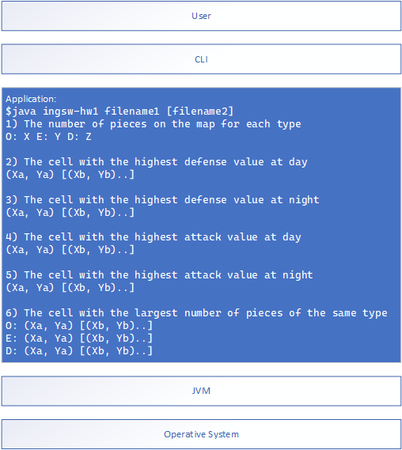
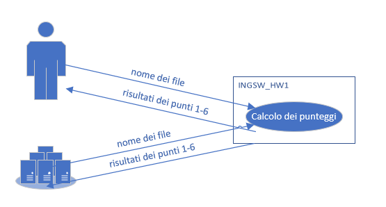
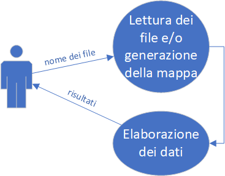
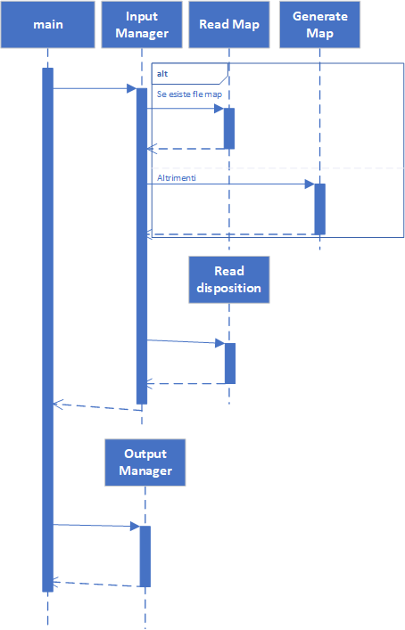
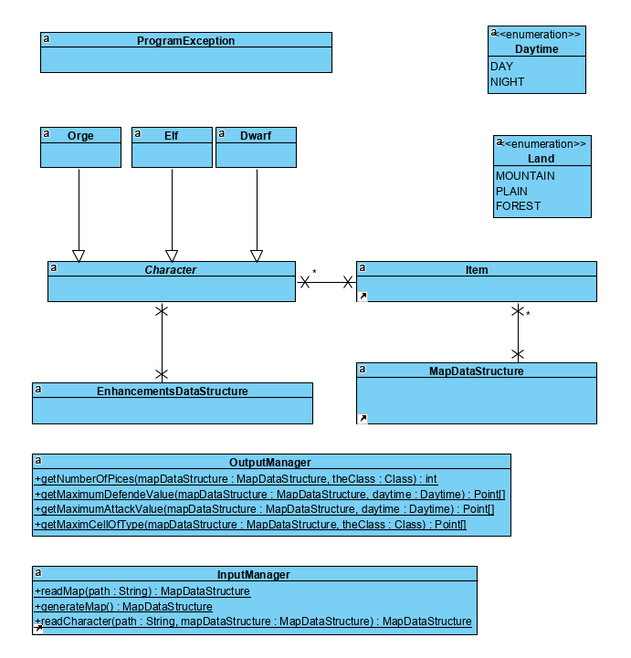

# IS1: primo homework
# Documento dei requisiti

# Prefazione


Questo è un documento di specifica dei requisiti per il sistema “INGSW_HW1”. INGSW_HW1 è una semplice applicazione che si occupa di analizzare il contenuto di una mappa rettangolare contenente alcuni personaggi di L.o.t.R. Questi personaggi hanno delle abilità classiche e delle abilità aggiuntive in determinate situazioni temporali e spaziali.

Questo documento descrive lo scopo, gli obiettivi e gli obiettivi del nuovo sistema. Oltre a descrivere i requisiti non funzionali, questo documento modella i requisiti funzionali con casi d'uso, diagrammi di interazione e modelli di classe. Questo documento ha lo scopo di orientare la progettazione e l'implementazione del sistema target in un linguaggio orientato agli oggetti.


# Introduzione

INGSW_HW1 si occupa principalmente di trovare le celle dove i personaggi di L.o.t.R sono più performanti e/o dove sono presenti di più.

Il seguente software è stand-alone, riceve in input alcuni parametri che contengono nomi di file e genera in output i calcoli, questo programma può essere senza grossi problemi incluso in altri software, richiamato da script web, …

I committenti di questo software sono due: Giacomo Seno e Matteo Lando. Con loro ho svolto 3 interviste a testa (per un totale di 6) gran parte dei conflitti si sono risolti accettando entrambe le modalità. Le interviste si sono svolte in maniera indipendente e senza memoria per evitare che un committente influenzi l’altro. Uno dei due committenti ha ritenuto opportuno commentare la traccia base con specificazioni, l’altro ha solamente risposto a domande. Il riassunto delle interviste è racchiuso nel file INGSW_HW1  - interviste con i committenti


# Glossario

**X**: coordinata longitudinale della mappa (0 più a sinistra, ∞ più a destra)

**Y**: coordinata latitudinale della mappa (0 più in alto, ∞ più in basso)

**M**: dimensione longitudinale della mappa corrispondente, per motivi legati all’informatica ad l’ultimo X ammesso + 1

**N**: dimensione latitudinale della mappa corrispondente, per motivi legati all’informatica ad l’ultimo Y ammesso + 1

**path**: percorso completo/relativo di un nome di un file 

**punti 1-6**: si intendono i seguenti calcoli

1) Il numero di pezzi presenti sulla mappa per ciascuna tipologia; 

2) La casella con il maggior valore di difesa di giorno 

3) La casella con il maggior valore di difesa di notte 

4) La casella con il maggior valore di attacco di giorno 

5) La casella con il maggior valore di attacco di notte 

6) La casella con il maggior numero di pezzi dello stesso tipo

**punti 2-6**: si intendono i punti 1-6 senza il punto 1.

**L.o.t.R**: The Lord of the Rings - Il Signore degli Anelli

**Struttura dati**: è un'entità usata per organizzare un insieme di dati all'interno della memoria del computer, ed eventualmente per memorizzarli


# Requisiti utente


## Interazione con l’utente

L’utente deve poter avviare l’applicazione tramite terminale passando uno o più path come args e leggere tramite standard output il risultato della elaborazione. Il programma funziona attraverso la CLI e non tramite GUI e/o pagine web.


## Usabilità

I file di input e le scritte in output devono essere effettuate in un inglese comprensibile all’utente comune. La scelta della lingua inglese è dovuta ai riferimenti fatti dai committenti. Ovviamente dato la piccola dimensione del s.w. è facilmente localizzabile in inglese. 


## Prestazioni

I risultati devono essere caricati in un tempo proporzionale alla dimensione dei file, della velocità del PC e proporzionale al numero di celle. Se il file è una matrice 1000x1000 non è richiesto che il computer risponda in 0,0001 secondi, ma in un tempo proporzionale alla dimensione della matrice.


## Affidabilità

Il software deve ritornare risultati corretti nel 100% delle volte.


## Sicurezza

Il sistema non richiede sistemi di sicurezza e privacy


## Supportabilità

Il sistema deve poter girare su qualsiasi JVM, non sono supportate librerie posizionate in path fisse o altre cose che rendono il software difficilmente utilizzabile in altre piattaforme, bisogna ricordare anche la possibile futura necessità che il software sia compilabile attraverso i comuni sistemi di CI/CD dei sistemi di versioning 


## Documentazione e guida per l'utente

Prevedere un comando --help (o con nome simile) per permettere di sapere come passare gli args a riga di comando


## Interfacce

Il sistema deve interfacciarsi con uno o due file e lo standard output / error.


# Architettura del sistema

Il software è un semplice script da riga di comando che dato un input genera un semplice output. Il software può essere usato sia da persone che da altri software. Il software riceve da args uno o due path che contengono il nome relativamente di uno o due file contenente le informazioni da elaborare. Il sistema si occupa di elaborare le informazioni ricevute e generare un output.





# Requisiti di sistema


<table>
  <tr>
   <td>INGSW_HW1/Model/Land
   </td>
  </tr>
  <tr>
   <td>Funzione: Lista di possibili ambientazioni (montagna, pianura, bosco)
   </td>
  </tr>
  <tr>
   <td>Descrizione: Si occupa di descrivere le possibili ambientazioni
   </td>
  </tr>
  <tr>
   <td>Destination: Model
   </td>
  </tr>
  <tr>
   <td>Requirements: una enumerazione contenente 3 dati
   </td>
  </tr>
</table>


<table>
  <tr>
   <td>INGSW_HW1/Model/Daytime
   </td>
  </tr>
  <tr>
   <td>Funzione: Lista di possibili daytime (giorno, notte)
   </td>
  </tr>
  <tr>
   <td>Descrizione: Si occupa di descrivere le possibili daytime 
   </td>
  </tr>
  <tr>
   <td>Destination: Model
   </td>
  </tr>
  <tr>
   <td>Requirements: una enumerazione contenente 2 dati
   </td>
  </tr>
</table>


<table>
  <tr>
   <td>INGSW_HW1/Model/Character
   </td>
  </tr>
  <tr>
   <td>Funzione: Lista di possibili personaggi (elfo, orco, nano)
   </td>
  </tr>
  <tr>
   <td>Descrizione: Si occupa di descrivere i possibili personaggi
   </td>
  </tr>
  <tr>
   <td>Destination: Model
   </td>
  </tr>
  <tr>
   <td>Requirements:  una classe astratte e 3 classi di specializzazioni, I valori di attacco e difesa sono inizialmente definiti per tipologia (A/D) Elfo 5/2; Nano 2/5; Orco 4/4, I pezzi sono caratterizzati da modificatori di combattimento (+A%/+D%): elfi bosco +0%/+100%; nani montagna +100%/+0%; orco giorno -50%/-50%; orco notte +50%/+50%.
<p>
Bisogna quindi implementare una apposita struttura dati (INGSW_HW1/Data_structure/Enhancements_data_structure)
   </td>
  </tr>
</table>


<table>
  <tr>
   <td>INGSW_HW1/Data_structure/Map_data_structure
   </td>
  </tr>
  <tr>
   <td>Funzione: Struttura dati più adeguata al SW per la gestione della mappa
   </td>
  </tr>
  <tr>
   <td>Descrizione: Struttura dati che permette di avere una matrice con all’interno di ogni cella una lista
   </td>
  </tr>
  <tr>
   <td>Requirements: La struttura dati deve permette un accesso casuale attraverso due coordinate (X e Y), ad ogni singola coordinata deve essere presente una lista che può contenere da 0 a 5 elementi
<p>
Deve avere un apposito metodo che dato (x,y) ritorni la lista di personaggi
<p>
Non deve avere nessun riferimento temporale giorno/notte
   </td>
  </tr>
</table>


<table>
  <tr>
   <td>INGSW_HW1/Data_structure/Enhancements_data_structure
   </td>
  </tr>
  <tr>
   <td>Funzione: Struttura dati più adeguata al SW per i potenziamenti
   </td>
  </tr>
  <tr>
   <td>Descrizione: Struttura dati che gestire in maniera semplice i potenziamenti
   </td>
  </tr>
  <tr>
   <td>Requirements: La struttura dati deve poter:
<ul>

<li>Riempire tutte le celle Daytime.day o Daytime.night senza specificare i vari tipi di Land

<li>Riempire tutte le celle Land.plain, Land.mountain, Land.forest senza specificare i vari tipi di Day

<li>Riempire di default tutti i potenziamenti a 0

<li>Accedere in lettura e scrittura per tutte le possibili coppie Daytime e Land.
</li>
</ul>
   </td>
  </tr>
</table>


<table>
  <tr>
   <td>INGSW_HW1/Input_Manager/Read_Map
   </td>
  </tr>
  <tr>
   <td>Funzione: Lettura di un file di testo contenente le informazioni della mappa
   </td>
  </tr>
  <tr>
   <td>Descrizione: Legge il file con path passata come argomento contenente le informazioni sulla mappa. il file è già formattato e non serve cont
   </td>
  </tr>
  <tr>
   <td>Inputs: Una stringa contenente il path preso da args
   </td>
  </tr>
  <tr>
   <td>Source: Hard disk, variabili in memoria 
   </td>
  </tr>
  <tr>
   <td>Outputs: Matrice MxN contenente i vari elementi: Bosco, Pianura, Montagna
   </td>
  </tr>
  <tr>
   <td>Destination: Input Manager
   </td>
  </tr>
  <tr>
   <td>Action: lettura del file di testo e trasformazione in una matrice MxN contenente delle istanze delle classi
<p>
Controllare che la dimensione della matrice sia regolare
   </td>
  </tr>
  <tr>
   <td>Requirements: File di testo già formattato secondo la seguente specifica:
<p>
F, f: bosco, P, p: pianura, M, m: montagna, es:
<pre>
PmmmmmPM
MFMFPFFF
FFMMFPMP
MFFPFFMP
FMFMMPPF
mpfmpfmf
FFMPMPMM
FPFFFPMF
</pre>
Il file di testo usa come delimitatore delle righe l’andatura a capo. Ogni singolo carattere corrisponde ad una cella. Non sono ammesse matrici non regolari, Ogni cella della mappa ha una e una sola tipologia (pianura/bosco/montagna), 
<p>
La prima cella inizia da 0,0 e si trova nell’angolo superiore sinistro
   </td>
  </tr>
  <tr>
   <td>Post-condition: Chiudere il file
   </td>
  </tr>
</table>


<table>
  <tr>
   <td>INGSW_HW1/Input_Manager/Generate_Map
   </td>
  </tr>
  <tr>
   <td>Funzione: Genera una mappa 8x8 random
   </td>
  </tr>
  <tr>
   <td>Descrizione: Riempie una matrice 8x8 con elementi random
   </td>
  </tr>
  <tr>
   <td>Outputs: Matrice 8x8 contenente i vari elementi: Bosco, Pianura, Montagna
   </td>
  </tr>
  <tr>
   <td>Destination: Input Manager
   </td>
  </tr>
  <tr>
   <td>Action: lettura del file di testo e trasformazione in una matrice MxN contenente delle istanze delle classi
   </td>
  </tr>
  <tr>
   <td>Requirements: Ogni cella della mappa ha una e una sola tipologia (pianura/bosco/montagna), 
<p>
La prima cella inizia da 0,0 e si trova nell’angolo superiore sinistro
<p>
Un algoritmo per generare in maniera ramdom
   </td>
  </tr>
</table>


<table>
  <tr>
   <td>INGSW_HW1/Input_Manager/Read_disposition
   </td>
  </tr>
  <tr>
   <td>Funzione: Lettura di un file di testo contenente le disposizione degli elementi della mappa
   </td>
  </tr>
  <tr>
   <td>Descrizione: Si occupa di leggere il file formattato in due possibili modi e di generare una apposita struttura dati (INGSW_HW1/Data_structure/Map_data_structure) contenente tutte la mappa ed i relativi elementi
   </td>
  </tr>
  <tr>
   <td>Inputs: Una stringa contenente il path preso da args, la matrice contenente la struttura della mappa
   </td>
  </tr>
  <tr>
   <td>Source: Hard disk e variabili in memoria
   </td>
  </tr>
  <tr>
   <td>Outputs: genera una mappa che come chiave ha una coordinata (X,Y) e come valore una lista con 0..5 elementi (ammessi sia 0 che 5 elementi), Ogni pezzo e’ caratterizzato da un tipo {elfo/nano/orco}
   </td>
  </tr>
  <tr>
   <td>Destination: Input Manager
   </td>
  </tr>
  <tr>
   <td>Action: lettura del file di testo e realizzazione di una appropriata matrice/dizionario/lista contenente le informazioni della matrice mappa e le informazioni lette dal file.
   </td>
  </tr>
  <tr>
   <td>Requirements: File di testo formattato
<p>
Si leggano i dati relativi ad i pezzi da disporre sulla mappa da un file contenente gruppi di linee di testo secondo il formato:
<pre class="prettyprint">
X
Y
tipo
</pre>
<p>

In caso di più elementi nella stessa cella è possibile usare entrambe le seguenti strategie:

<pre class="prettyprint">
Xa 
Ya
tipo1a
tipo2a
tipo3a

Xb
Yb
tipo1b

Xb
Yb
tipo2b
</pre>
   </td>
  </tr>
  <tr>
   <td>Post-condition: Chiudere il file
   </td>
  </tr>
</table>


<table>
  <tr>
   <td>INGSW_HW1/Output_Manager/Calculations
   </td>
  </tr>
  <tr>
   <td>Funzione: Data la struttura dati riempita vengono effettuati i calcoli richiesti
   </td>
  </tr>
  <tr>
   <td>Descrizione: Trovare all’interno della matrice alcune celle che corrispondono a determinati valori
   </td>
  </tr>
  <tr>
   <td>Inputs: Struttura dati (INGSW_HW1/Data_structure/Map_data_structure) riempita
   </td>
  </tr>
  <tr>
   <td>Source: Variabili in memoria
   </td>
  </tr>
  <tr>
   <td>Outputs: Risultati dei calcoli
   </td>
  </tr>
  <tr>
   <td>Destination: Output Manager
   </td>
  </tr>
  <tr>
   <td>Action: calcola i punti descritti nella successiva riga della tabella a partire da una matrice
   </td>
  </tr>
  <tr>
   <td>Requirements: 
<p>
1) Il numero di pezzi presenti sulla mappa per ciascuna tipologia; 
<p>
2) La casella con il maggior valore di difesa di giorno 
<p>
3) La casella con il maggior valore di difesa di notte 
<p>
4) La casella con il maggior valore di attacco di giorno 
<p>
5) La casella con il maggior valore di attacco di notte 
<p>
6a) La casella con il maggior numero di pezzi dello stesso tipo: Orco
<p>
6b) La casella con il maggior numero di pezzi dello stesso tipo: Elfo
<p>
6c) La casella con il maggior numero di pezzi dello stesso tipo: Nano
<p>
In caso di più celle con lo stesso valore massimo si stampano TUTTE.
<p>
Nel primo caso viene stampata una mappa del seguente formato:
<p>
<code>O:10 E:20 N:30</code>
<p>
Negli altri punti semplicemente una coordinata (X,Y). Tra un punto e l’altro serve metterci una riga bianca
   </td>
  </tr>
  <tr>
   <td>Pre-condition: aver letto la struttura dati
   </td>
  </tr>
  <tr>
   <td>Side effects: Questi dati vengono semplicemente stampati nello standard output in un formato non parsabile direttamente da altri software, ma richiede l’utilizzo di regex.
   </td>
  </tr>
</table>


<table>
  <tr>
   <td>INGSW_HW1/Main
   </td>
  </tr>
  <tr>
   <td>Funzione: Init del programma, lettura degli args, e lancio delle procedure
   </td>
  </tr>
  <tr>
   <td>Descrizione: Questo requisito indica come deve essere il flusso di esecuzione del programma
   </td>
  </tr>
  <tr>
   <td>Inputs: rige di args
   </td>
  </tr>
  <tr>
   <td>Source: argomento a riga di comando
   </td>
  </tr>
  <tr>
   <td>Outputs: cout
   </td>
  </tr>
  <tr>
   <td>Action: 
<ol>

<li>call della routine per leggere e/o generare la mappa passando il nome del file, se presente

<li>call della routine per leggere la posizione dei personaggi passando il nome del file

<li>call delle routine per generare gli output
</li>
</ol>
   </td>
  </tr>
  <tr>
   <td>Requirements: L’applicazione non deve ricevere nessun input al di fuori del file .txt,
<p>
non deve interagire con l’utente attraverso il buffer di scrittura standard,
<p>
L’unico output è quello richiesto dai 6 punti precedenti quindi non c’è bisogno che venga visualizzata la mappa o altro,
<p>
In caso di errore deve venire scritto a schermo un semplice messaggio del tipo “qualcosa è andato storto”,
<p>
L’output deve venire espresso in sequenza e i dati devono essere separati da una riga vuota.
<p>
Se possibile bisogna far proseguire il programma anche in caso di errori
   </td>
  </tr>
</table>


# Modello di sistema


## Contesto

Il contesto dell’applicazione è un’applicazione stand-alone, indipendente da qualsiasi altra applicazione ed è possibile eseguirla su qualsiasi macchina che abbia la JVM.





## Caso d’uso




<table>
  <tr>
   <td>Use Case: Uso dell'applicazione
   </td>
  </tr>
  <tr>
   <td>Summary: Flusso principale dell’applicazione
   </td>
  </tr>
  <tr>
   <td>Basic Flow: 
<ol>

<li>l’utente lancia l’applicazione con due path alla riga di comando

<li>l’applicazione carica i file e genera una matrice

<li>l’applicazione calcola i punti 1-6 e li stampa
</li>
</ol>
   </td>
  </tr>
  <tr>
   <td>Alternative Flows:
<p>
Step 1) Se l’utente non mette il secondo file viene generato una mappa casuale 8x8
   </td>
  </tr>
  <tr>
   <td>Preconditions: L’utente deve avere la JVM ed almeno un file
   </td>
  </tr>
  <tr>
   <td>Postconditions: L’utente ora può sapere i punti 1-6
   </td>
  </tr>
</table>


## Diagramma temporale





## Modello di struttura





## Design di struttura


# Evoluzione del sistema

Non sono previsti sistemi di aggiornamento, e release future.


# Appendice

Si rimanda al documento di architettura del software per una descrizione più chiara delle seguenti strutture dati.

Struttura della Data structure da implementare nel requisito “INGSW_HW1/Data_structure/Map_data_structure”


<table>
  <tr>
   <td>
   </td>
   <td>0
   </td>
   <td>1
   </td>
   <td>...
   </td>
   <td>N
   </td>
  </tr>
  <tr>
   <td>0
   </td>
   <td>


<pre class="prettyprint">Land</pre>


<table>
  <tr>
   <td>Character[0]
   </td>
  </tr>
  <tr>
   <td>Character[1]
   </td>
  </tr>
  <tr>
   <td>Character[2]
   </td>
  </tr>
  <tr>
   <td>Character[3]
   </td>
  </tr>
  <tr>
   <td>Character[4]
   </td>
  </tr>
</table>


   </td>
   <td>

```
Land
```


<table>
  <tr>
   <td>Character[0]
   </td>
  </tr>
  <tr>
   <td>Character[1]
   </td>
  </tr>
  <tr>
   <td>Character[2]
   </td>
  </tr>
  <tr>
   <td>Character[3]
   </td>
  </tr>
  <tr>
   <td>Character[4]
   </td>
  </tr>
</table>


   </td>
   <td>
   </td>
   <td>

```
Land
```


<table>
  <tr>
   <td>Character[0]
   </td>
  </tr>
  <tr>
   <td>Character[1]
   </td>
  </tr>
  <tr>
   <td>Character[2]
   </td>
  </tr>
  <tr>
   <td>Character[3]
   </td>
  </tr>
  <tr>
   <td>Character[4]
   </td>
  </tr>
</table>


   </td>
  </tr>
  <tr>
   <td>1

   </td>
   <td>

```
Land
```


<table>
  <tr>
   <td>Character[0]
   </td>
  </tr>
  <tr>
   <td>Character[1]
   </td>
  </tr>
  <tr>
   <td>Character[2]
   </td>
  </tr>
  <tr>
   <td>Character[3]
   </td>
  </tr>
  <tr>
   <td>Character[4]
   </td>
  </tr>
</table>


   </td>
   <td>

```
Land
```


<table>
  <tr>
   <td>Character[0]
   </td>
  </tr>
  <tr>
   <td>Character[1]
   </td>
  </tr>
  <tr>
   <td>Character[2]
   </td>
  </tr>
  <tr>
   <td>Character[3]
   </td>
  </tr>
  <tr>
   <td>Character[4]
   </td>
  </tr>
</table>


   </td>
   <td>
   </td>
   <td>

```
Land
```


<table>
  <tr>
   <td>Character[0]
   </td>
  </tr>
  <tr>
   <td>Character[1]
   </td>
  </tr>
  <tr>
   <td>Character[2]
   </td>
  </tr>
  <tr>
   <td>Character[3]
   </td>
  </tr>
  <tr>
   <td>Character[4]
   </td>
  </tr>
</table>


   </td>
  </tr>
  <tr>
   <td>...

   </td>
   <td>
   </td>
   <td>
   </td>
   <td>
   </td>
   <td>
   </td>
  </tr>
  <tr>
   <td>N

   </td>
   <td>

```
Land
```


<table>
  <tr>
   <td>Character[0]
   </td>
  </tr>
  <tr>
   <td>Character[1]
   </td>
  </tr>
  <tr>
   <td>Character[2]
   </td>
  </tr>
  <tr>
   <td>Character[3]
   </td>
  </tr>
  <tr>
   <td>Character[4]
   </td>
  </tr>
</table>


   </td>
   <td>

```
Land
```


<table>
  <tr>
   <td>Character[0]
   </td>
  </tr>
  <tr>
   <td>Character[1]
   </td>
  </tr>
  <tr>
   <td>Character[2]
   </td>
  </tr>
  <tr>
   <td>Character[3]
   </td>
  </tr>
  <tr>
   <td>Character[4]
   </td>
  </tr>
</table>


   </td>
   <td>
   </td>
   <td>

```
Land
```


<table>
  <tr>
   <td>Character[0]
   </td>
  </tr>
  <tr>
   <td>Character[1]
   </td>
  </tr>
  <tr>
   <td>Character[2]
   </td>
  </tr>
  <tr>
   <td>Character[3]
   </td>
  </tr>
  <tr>
   <td>Character[4]
   </td>
  </tr>
</table>


   </td>
  </tr>
</table>


Struttura dati della “INGSW_HW1/Data_structure/Enhancements_data_structure”


```
Valore base
```


<table>
  <tr>
   <td>
   </td>
   <td>Land.plain
   </td>
   <td>Land.mountain
   </td>
   <td>Land.forest
   </td>
  </tr>
  <tr>
   <td>Daytime.day
   </td>
   <td>Valore di potenziamento
   </td>
   <td>Valore di potenziamento
   </td>
   <td>Valore di potenziamento
   </td>
  </tr>
  <tr>
   <td>Daytime.night
   </td>
   <td>Valore di potenziamento
   </td>
   <td>Valore di potenziamento
   </td>
   <td>Valore di potenziamento
   </td>
  </tr>
</table>
