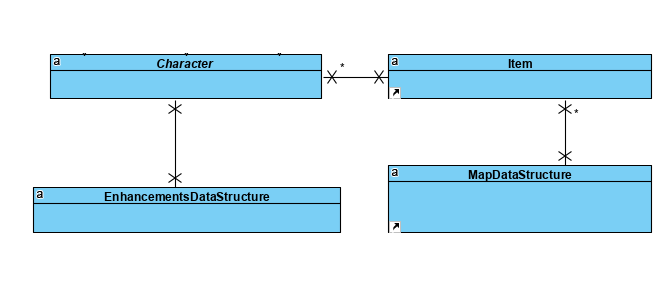
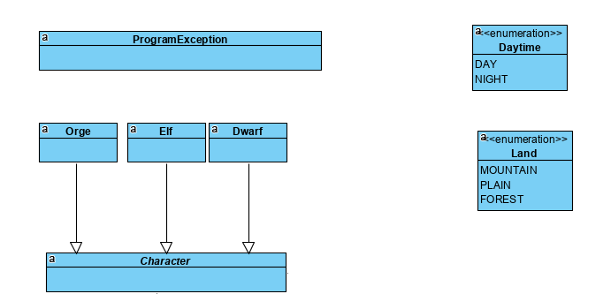
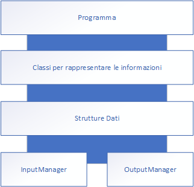
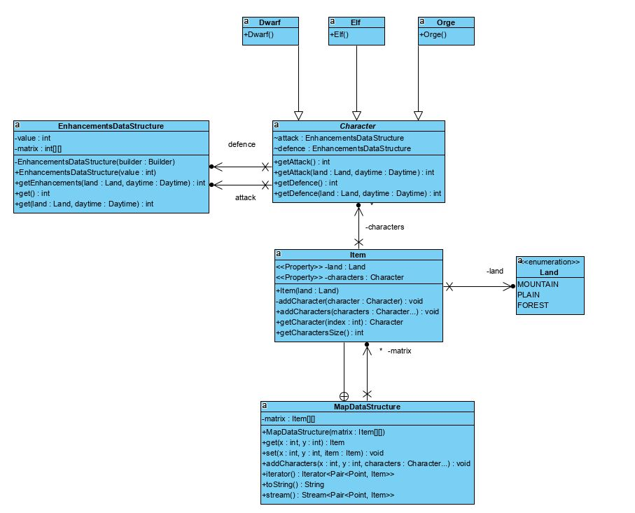
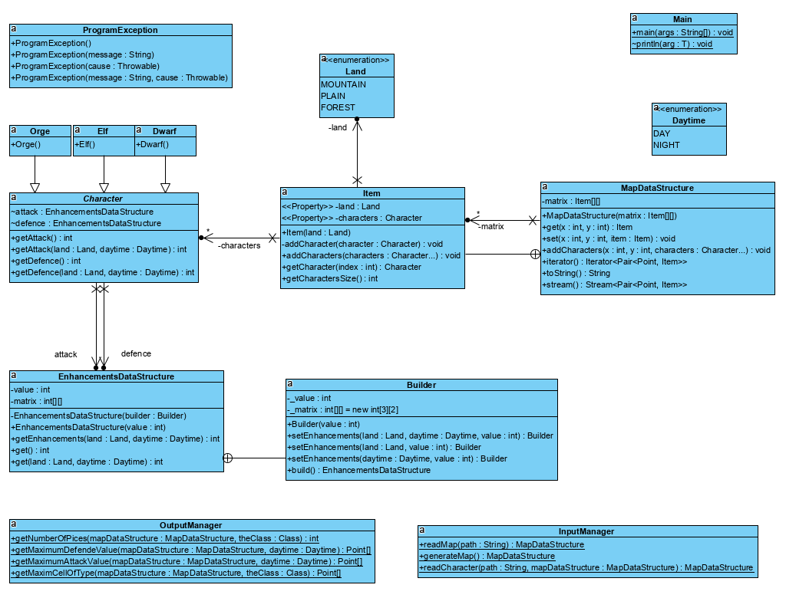

# IS1: primo homework
# Documento di architettura

# Prefazione

Questo è un documento di architettura per il sistema “INGSW_HW1”. INGSW_HW1 è una semplice applicazione che si occupa di analizzare il contenuto di una mappa rettangolare contenente alcuni personaggi di L.o.t.R. Questi personaggi hanno delle abilità classiche e delle abilità aggiuntive in determinate situazioni temporali e spaziali.

Questo documento descrive lo scopo, gli obiettivi e gli obiettivi del nuovo sistema. Oltre a descrivere i requisiti non funzionali, questo documento modella i requisiti funzionali con casi d'uso, diagrammi di interazione e modelli di classe. Questo documento ha lo scopo di orientare la progettazione e l'implementazione del sistema target in un linguaggio orientato agli oggetti.


# Introduzione

Questo documento fornisce una panoramica architettonica completa del sistema, utilizzando una serie di punti di vista architettonici diversi per descrivere i diversi aspetti del sistema. Il suo scopo è quello di catturare e trasmettere le significative decisioni architettoniche che sono state prese sul sistema. Questo documento elabora l'architettura del sistema in 5 diverse viste. (Modello a 4+1 viste). Il comportamento statico e dinamico del sistema è descritto in questo documento. Tutti i diagrammi richiesti e le loro descrizioni sono disponibili in questo documento. L'utilizzo del modello di vista 4+1 permette di rappresentare il software nel modo più accurato possibile. Esso permette ad un'ampia gamma di soggetti interessati di trovare ciò di cui hanno bisogno nel documento di architettura. 

Poiché il modello di vista 4+1 viene utilizzato come modello di riferimento, esso incorpora molte viste del sistema, rendendo così il documento completo e coerente. Sotto il comportamento statico del sistema, il documento discute i diagrammi di classe, i diagrammi dei pacchetti e altri progetti di architettura statica. Gli aspetti dinamici del sistema sono elaborati utilizzando realizzazioni di casi d'uso e diagrammi di sequenza del sistema. 

# Glossario

**X**: coordinata longitudinale della mappa (0 più a sinistra, ∞ più a destra)

**Y**: coordinata latitudinale della mappa (0 più in alto, ∞ più in basso)

**M**: dimensione longitudinale della mappa corrispondente, per motivi legati all’informatica ad l’ultimo X ammesso + 1

**N**: dimensione latitudinale della mappa corrispondente, per motivi legati all’informatica ad l’ultimo Y ammesso + 1

**path**: percorso completo/relativo di un nome di un file 

**punti 1-6**: si intendono i seguenti calcoli

1) Il numero di pezzi presenti sulla mappa per ciascuna tipologia; 

2) La casella con il maggior valore di difesa di giorno 

3) La casella con il maggior valore di difesa di notte 

4) La casella con il maggior valore di attacco di giorno 

5) La casella con il maggior valore di attacco di notte 

6) La casella con il maggior numero di pezzi dello stesso tipo

**punti 2-6**: si intendono i punti 1-6 senza il punto 1.

**L.o.t.R**: The Lord of the Rings - Il Signore degli Anelli

**Struttura dati**: è un'entità usata per organizzare un insieme di dati all'interno della memoria del computer, ed eventualmente per memorizzarli

**OOP**: Programmazione orientata agli oggetti 


# Use Case View


<table>
  <tr>
   <td>Use Case: Uso dell'applicazione
   </td>
  </tr>
  <tr>
   <td>Scenario: Flusso principale dell’applicazione
   </td>
  </tr>
  <tr>
   <td>Descrizione: Quando l'utente e/o un software lancia l'applicazione passando tramite arg uno o due path il programma si occupa di leggere i file ed effettuare i calcoli richiesti, e mandali in output
   </td>
  </tr>
  <tr>
   <td>Attori: Utente o altro software
   </td>
  </tr>
  <tr>
   <td>Precondizioni: L’utente deve avere la JVM, Avere almeno il file con la disposizione dei personaggi e opzionalmente il file con la mappa.
   </td>
  </tr>
  <tr>
   <td>Basic Flow: 
<ol>

<li>l’utente lancia l’applicazione con due path alla riga di comando

<li>l’applicazione carica i file e genera una matrice

<li>l’applicazione calcola i punti 1-6 e li stampa
</li>
</ol>
   </td>
  </tr>
  <tr>
   <td>Alternative Flows:
<p>
Step 1) Se l’utente non mette il secondo file viene generato una mappa casuale 8x8
   </td>
  </tr>
  <tr>
   <td>Exception conditions: In caso che nessun file viene passato e/o in caso che i file siano generati in modo errato. In caso che l'utente metta --help viene stampato un semplice messaggio di suggerimento
   </td>
  </tr>
  <tr>
   <td>Postconditions: L’utente ora può sapere i punti 1-6
   </td>
  </tr>
</table>


# Logical View

## Sottosistemi

"INGSW_HW1" è possibile dividerlo in 4 sottosistemi:
1. Strutture dati 
2. Classi per rappresentare le informazioni
3. InputManager
4. OutputManager

### Strutture dati

Questo sottosistema si occupa di creare le strutture dati atte alla memorizzazione dei dati letti da file, le strutture dati sono una composizione di array, matrici e liste create appositamente per memorizzare i dati quì presenti. Prevedono metodi wrapper e un Java Builder per rendere più intuitivo l'uso.
Le strutture dati, ove possibile, utilizzano tutte le feature del linguaggio Java come Iterator e Stream per permettere una elaborazione semplice e veloce dei dati cercando di ridurre al minimo l'utilizzo di cicli for e while per rendere più leggibile il software oltre che più moderno.




### Classi per rappresentare le informazioni

Fanno parte di questo sottinsieme tutte le classi e le enum utilizzate per rappresentare le informazioni. Sono presenti 2 enum, una classe base e 3 classi specializzate.



### InputManager

Questo sottosistema si occupa di leggere da file e generare una mappa se l'apposito file mappa non è stato passato come argomento. Queste funzioni sono create cercando di utilizzare al 100% le funzioni ed i trick delle strutture dati.

### OutputManager

Questo sottosistema si occupa di calcolare i punti 1-6 ricevendo come input le mappe. Queste funzioni sono create cercando di utilizzare al 100% le funzioni ed i trick delle strutture dati.




# Process View

Quando l'utente (o un altro software) avvia l'applicazione fornendo come args il file e/o i file il software inizia a leggere (o generare, se il file relativo alla mappa non è presente) la mappa. Una volta riempita la mappa vengono calcolati i vari punti da 1-6 e vengono stampati in output.


## Diagramma di attività


# Implementation View

"INGSW_HW1" è un software basato su 4 sottoinsiemi


In particolare:
1. Strutture dati 
2. Classi per rappresentare le informazioni
3. InputManager
4. OutputManager

### Strutture dati

Le strutture dati possono essere rappresentate in questo modo:

Struttura della Data structure da implementare nel requisito “INGSW_HW1/Data_structure/Map_data_structure”


<table>
  <tr>
   <td>
   </td>
   <td>0
   </td>
   <td>1
   </td>
   <td>...
   </td>
   <td>N
   </td>
  </tr>
  <tr>
   <td>0
   </td>
   <td>


<pre class="prettyprint">Land</pre>


<table>
  <tr>
   <td>Character[0]
   </td>
  </tr>
  <tr>
   <td>Character[1]
   </td>
  </tr>
  <tr>
   <td>Character[2]
   </td>
  </tr>
  <tr>
   <td>Character[3]
   </td>
  </tr>
  <tr>
   <td>Character[4]
   </td>
  </tr>
</table>


   </td>
   <td>

```
Land
```


<table>
  <tr>
   <td>Character[0]
   </td>
  </tr>
  <tr>
   <td>Character[1]
   </td>
  </tr>
  <tr>
   <td>Character[2]
   </td>
  </tr>
  <tr>
   <td>Character[3]
   </td>
  </tr>
  <tr>
   <td>Character[4]
   </td>
  </tr>
</table>


   </td>
   <td>
   </td>
   <td>

```
Land
```


<table>
  <tr>
   <td>Character[0]
   </td>
  </tr>
  <tr>
   <td>Character[1]
   </td>
  </tr>
  <tr>
   <td>Character[2]
   </td>
  </tr>
  <tr>
   <td>Character[3]
   </td>
  </tr>
  <tr>
   <td>Character[4]
   </td>
  </tr>
</table>


   </td>
  </tr>
  <tr>
   <td>1

   </td>
   <td>

```
Land
```


<table>
  <tr>
   <td>Character[0]
   </td>
  </tr>
  <tr>
   <td>Character[1]
   </td>
  </tr>
  <tr>
   <td>Character[2]
   </td>
  </tr>
  <tr>
   <td>Character[3]
   </td>
  </tr>
  <tr>
   <td>Character[4]
   </td>
  </tr>
</table>


   </td>
   <td>

```
Land
```


<table>
  <tr>
   <td>Character[0]
   </td>
  </tr>
  <tr>
   <td>Character[1]
   </td>
  </tr>
  <tr>
   <td>Character[2]
   </td>
  </tr>
  <tr>
   <td>Character[3]
   </td>
  </tr>
  <tr>
   <td>Character[4]
   </td>
  </tr>
</table>


   </td>
   <td>
   </td>
   <td>

```
Land
```


<table>
  <tr>
   <td>Character[0]
   </td>
  </tr>
  <tr>
   <td>Character[1]
   </td>
  </tr>
  <tr>
   <td>Character[2]
   </td>
  </tr>
  <tr>
   <td>Character[3]
   </td>
  </tr>
  <tr>
   <td>Character[4]
   </td>
  </tr>
</table>


   </td>
  </tr>
  <tr>
   <td>...

   </td>
   <td>
   </td>
   <td>
   </td>
   <td>
   </td>
   <td>
   </td>
  </tr>
  <tr>
   <td>N

   </td>
   <td>

```
Land
```


<table>
  <tr>
   <td>Character[0]
   </td>
  </tr>
  <tr>
   <td>Character[1]
   </td>
  </tr>
  <tr>
   <td>Character[2]
   </td>
  </tr>
  <tr>
   <td>Character[3]
   </td>
  </tr>
  <tr>
   <td>Character[4]
   </td>
  </tr>
</table>


   </td>
   <td>

```
Land
```


<table>
  <tr>
   <td>Character[0]
   </td>
  </tr>
  <tr>
   <td>Character[1]
   </td>
  </tr>
  <tr>
   <td>Character[2]
   </td>
  </tr>
  <tr>
   <td>Character[3]
   </td>
  </tr>
  <tr>
   <td>Character[4]
   </td>
  </tr>
</table>


   </td>
   <td>
   </td>
   <td>

```
Land
```


<table>
  <tr>
   <td>Character[0]
   </td>
  </tr>
  <tr>
   <td>Character[1]
   </td>
  </tr>
  <tr>
   <td>Character[2]
   </td>
  </tr>
  <tr>
   <td>Character[3]
   </td>
  </tr>
  <tr>
   <td>Character[4]
   </td>
  </tr>
</table>


   </td>
  </tr>
</table>


Struttura dati della “INGSW_HW1/Data_structure/Enhancements_data_structure”


```
Valore base
```


<table>
  <tr>
   <td>
   </td>
   <td>Land.plain
   </td>
   <td>Land.mountain
   </td>
   <td>Land.forest
   </td>
  </tr>
  <tr>
   <td>Daytime.day
   </td>
   <td>Valore di potenziamento
   </td>
   <td>Valore di potenziamento
   </td>
   <td>Valore di potenziamento
   </td>
  </tr>
  <tr>
   <td>Daytime.night
   </td>
   <td>Valore di potenziamento
   </td>
   <td>Valore di potenziamento
   </td>
   <td>Valore di potenziamento
   </td>
  </tr>
</table>


# Classi per rappresentare le informazioni

Le Classi e le enum per rappresentare le informazioni sono relazionate alle classi dati secondo il seguente schema:




# Data View

Il diagramma generale delle classi e delle enum è il seguente:




# Esempio di file di input e di ouput

## File di mappa
<pre>
mmmmmfffpp
MFMFPFFFMM
FFMMFPMPFF
MFFPFFMPFF
FMFmmPPFFF
MPFPFPMMMM
FFMPMPMMMM
FPFFFPMFFM
FFFFFFFFFF
</pre>

## File con i personaggi
<pre>
0 
1
D
E
D
O

0
1
D

6
6
D
E
O
O

3
2
E
E
O
D
D

1
1
F
E
D
D
D

0
0
F
E
D
D
D

3
4
F
G
D
E
D

0
0
F

0
4
E
E
O
D

1
3
E
E
D
D

4
9
D
D
D
D
D

2
2
D
D
D

4
3
D
D
D
D
O

2
2
D
D

6
7
E
D
O

7
6
E
D
O

8
8
E
D
D
O

8
1
D
D
D

8
2
O
O
O

7
4
E
D
O

7
2
E
D
O

6
9
D
D
D

6
0
E
E
E

6
3
e
d

6
0
E
E

6
5
O
O
O

4
1
O
O
O

3
6
e
e
e
e
o
</pre>

## Esempio di output
<pre>
1) The number of pieces on the map for each type
O: 21 E: 25 D: 44

2) The cell with the highest defense value at day
(2,2), (4,9)

3) The cell with the highest defense value at night
(4,3)

4) The cell with the highest attack value at day
(6,0)

5) The cell with the highest attack value at night
(6,0)

6) The cell with the largest number of pieces of the same type
O: (4,1), (6,5), (8,2)
E: (6,0)
D: (2,2), (4,9)
</pre>

